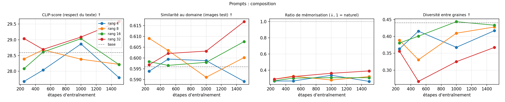
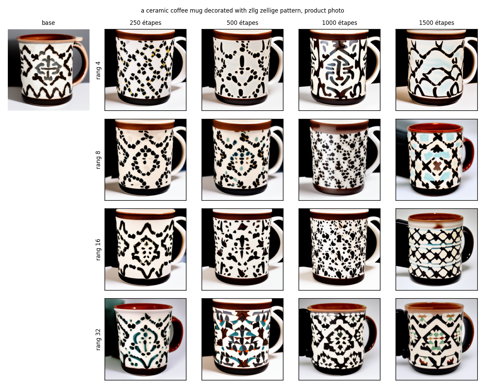

# LoRA Zellige — spécialiser un modèle texte-image avec peu de données

> **Projet 5 — IA générative visuelle.** On adapte Stable Diffusion 1.5 au **zellige marocain**
> avec une LoRA entraînée sur 20 à 50 images sous licence libre, sans réentraîner le modèle.
> On compare plusieurs **rangs** et **nombres d'étapes**, puis on mesure le **respect du texte**,
> le **coût** et le **surapprentissage**.

| | |
|---|---|
| Modèle de base | `stable-diffusion-v1-5/stable-diffusion-v1-5` (512 × 512) |
| Matériel | Google Colab / Kaggle, GPU T4 ou P100, **≤ 12 Go de VRAM** (pic mesuré ≈ 6-7 Go) |
| Jeton de concept | `zllg` → prompts du type « `zllg zellige, …` » |
| Équipe | Membre A · Membre B · Membre C *(à compléter)* |

---

## 1. Installation (Colab / Kaggle)

```bash
git clone https://github.com/braziyass/lora-zellige.git
cd lora-zellige
pip install -q -r requirements.txt
```

Ou ouvrez directement les notebooks de `notebooks/` (la première cellule fait l'installation).

## 2. Reproduire toutes les expériences

```bash
# 1) Données : téléchargement sous licence libre puis légendage MANUEL dans data/sources.csv
python data/download_commons.py --category "Zellij in Morocco" --limit 80
#    → ouvrir data/sources.csv, mettre keep=1/0 et écrire une légende courte par image
python -m src.prepare_data --config configs/base.yaml

# 2) Première LoRA simple (rang 8, 1500 étapes, ~15 min sur T4)
python -m src.train_lora --config configs/base.yaml

# 3) Balayage rangs 4/8/16/32 × checkpoints 250/500/1000/1500
python -m src.sweep --sweep configs/sweep.yaml

# 4) Génération (base + tous les checkpoints, mêmes prompts et graines)
python -m src.generate --config configs/base.yaml --include_base

# 5) Évaluation chiffrée + figures
python -m src.evaluate --config configs/base.yaml

# 6) Démo
python demo/app.py --share
```

## 3. Organisation du dépôt

| Dossier | Contenu |
|---|---|
| `notebooks/` | `01_donnees` · `02_baseline` · `03_entrainement_lora` · `04_evaluation` · `05_demo` |
| `src/` | `prepare_data` · `dataset` · `train_lora` · `sweep` · `generate` · `evaluate` · `plots` · `utils` |
| `configs/` | `base.yaml` (une expérience) · `sweep.yaml` (balayage) |
| `data/` | script de téléchargement, `sources.csv` (traçabilité des licences), fiche des données — **sans images** |
| `prompts/` | prompts d'évaluation (domaine + composition) |
| `results/` | tableaux de mesures et figures retenues |
| `demo/` | application Gradio + lien vers la vidéo |
| `report/` | rapport final (6-8 pages) |
| `docs/` | licences, fiche du modèle, éthique, planning, journal |

Les images, poids LoRA (`outputs/`) et générations brutes sont exclus de Git (`.gitignore`).
Les LoRA finales sont publiées sur Hugging Face Hub *(lien à ajouter)*.

## 4. Protocole d'évaluation

| Question | Mesure | Outil |
|---|---|---|
| Le modèle respecte-t-il le texte ? | **CLIP-score** (jeton `zllg` retiré du texte) sur prompts de *composition* | CLIP ViT-L/14 |
| A-t-il appris le domaine ? | **Similarité au domaine** : cosinus CLIP moyen avec les images de **test** réelles | CLIP ViT-L/14 |
| Surapprend-il / copie-t-il ? | **Similarité au plus proche voisin d'entraînement**, ratio vs le niveau naturel des images de test, taux de quasi-copies | DINOv2-small |
| Les sorties s'effondrent-elles ? | **Diversité** entre graines pour un même prompt | DINOv2-small |
| Combien ça coûte ? | Temps d'entraînement, pic de VRAM, paramètres entraînés, taille du fichier LoRA | `run_info.json` |

Trois familles de prompts (`prompts/eval_prompts.csv`) :
- **in_domain** : proches des légendes d'entraînement ;
- **held_out** : légendes des images de test, jamais vues ;
- **composition** : le concept dans un contexte nouveau (« une tasse décorée de zellige… »).
  Une LoRA qui surapprend produit du zellige **mais oublie la tasse** → son CLIP-score chute.

## 5. Résultats principaux *(à compléter)*

| Rang | Étapes | CLIP-score composition ↑ | Sim. domaine ↑ | Ratio mémorisation ↓ | Temps (min) | VRAM (Go) | Taille (Mo) |
|---|---|---|---|---|---|---|---|
| base | – | | | | – | – | – |
| 4 | 1000 | | | | | | |
| 8 | 1000 | | | | | | |
| 16 | 1000 | | | | | | |
| 32 | 1000 | | | | | | |




**Configuration retenue :** … · **Conclusion :** …

## 6. Éthique et licences

Voir [`docs/ETHIQUE.md`](docs/ETHIQUE.md), [`docs/LICENCES.md`](docs/LICENCES.md) et
[`docs/MODEL_CARD.md`](docs/MODEL_CARD.md). Chaque image d'entraînement est tracée
(auteur, licence, URL) dans `data/sources.csv`.

## 7. Contribuer

Voir [`CONTRIBUTING.md`](CONTRIBUTING.md) (issues, branches, messages de commit) et
le planning hebdomadaire dans [`docs/PLANNING.md`](docs/PLANNING.md).
